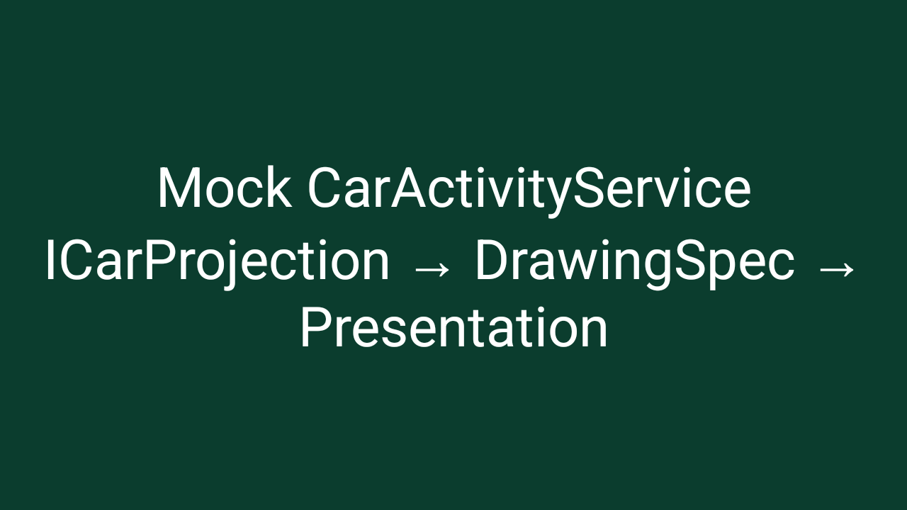
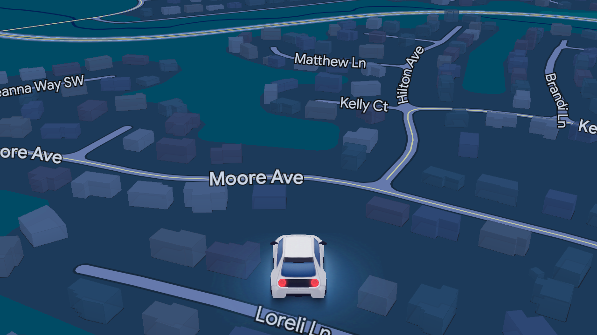

# Gearhead's projected-activity protocol (Maps, Waze, and the signature wall)

Status: **protocol mapped and demonstrated end to end: real Google Maps navigation pixels were
captured on rooted hardware with a UID-scoped Maps-process hook.** Written against gearhead
17.9.664044 and Maps 26.42/26.43. The initial mapping and the retail-device rejection were
observed on a Samsung SM-S948U1 (Android 17, unrooted); the successful pixel capture ran on a
rooted Pixel 10 Pro XL (Android 17) with Frida 17.24.3.

This document is the follow-up to [gearhead-notes.md](gearhead-notes.md). That file covers the
Android Auto transport (AAP), TLS, service discovery and the Car App Library host. This one covers
the *other* interface: the private `com.google.android.gms.car.ICarProjection` Binder that Google
Maps uses for its projected activity. Waze does **not** use it on current builds; see the last
section.

> Short version: the protocol is no longer the unknown. `ICarProjection` is a small Binder AIDL
> with 28 transactions; the host passes a `Surface` inside `DrawingSpec`; the app creates a
> `Presentation` on that surface. A mock service implementing the same Binder runs end to end.
> A real Maps install accepts the bind and then rejects the first transaction with
> `SecurityException: projection client manager does not have permission:
> android.permission.CAPTURE_VIDEO_OUTPUT`. That permission is `signature`, so an ordinary app
> cannot hold it. On a rooted Pixel, a Frida hook that returned `PERMISSION_GRANTED` for the
> probe's UID (and only that UID) got past the check; Maps then accepted `onProjectionStart`,
> resumed, and rendered its real navigation UI into the host surface. The protocol barrier is
> gone; the remaining barrier is the signature permission. Root alone, in a shell process, does
> not help because Android's ActivityManager will not bind a service for a process it does not
> know.

## 1. What the apps actually implement

Google Maps declares four exported car projection services in
`com.google.android.apps.maps` (manifest lines 1557-2431):

| service | categories | notes |
|---|---|---|
| `com.google.android.apps.gmm.car.GmmCarProjectionService` | `CATEGORY_PROJECTION`, `CATEGORY_PROJECTION_NAVIGATION` | the main phone projection service |
| `com.google.android.apps.gmm.car.LimitedGmmCarProjectionService` | `PROJECTION`, `AUXILIARY_DISPLAY`, `PROJECTION_NAVIGATION` | auxiliary display |
| `com.google.android.apps.gmm.car.WidescreenWidgetLimitedGmmCarProjectionService` | `PROJECTION`, `SECONDARY_REGION`, `PROJECTION_NAVIGATION` | secondary region |
| `com.google.android.apps.gmm.car.projected.auxiliarymap.GmmCarAuxiliaryProjectionService` | `PROJECTION`, `CLUSTER_DISPLAY`, `PROJECTION_NAVIGATION` | cluster map |

All four are `android:exported="true"` and have **no `android:permission`**. The main service is
also `foregroundServiceType="location"`. That looks like an open door; the door is locked inside
the process.

Maps' base class is `com.google.android.apps.auto.sdk.CarActivityService` (obfuscated `qzc` in
gearhead's bundled copy of the same SDK). `onBind()` returns an `rgm`/`beiy` Binder whose interface
descriptor is:

```
com.google.android.gms.car.ICarProjection
```

The app also returns a `CarActivity` class from `a()`; Maps returns `tok`, its projected activity.
The service is not an AndroidX `CarAppService`. No `androidx.car.app` template session is involved.

## 2. `ICarProjection` transactions

Transaction numbers are stable for this protocol. The server stub is `rgm` (gearhead) / `beiy`
(Maps); the client proxy is `rgn`/`rgo`. The host implements
`com.google.android.gms.car.ICarProjectionCallback` (`rgq`/`beiz`).

| tx | method | arguments |
|---:|---|---|
| 1 | `onSetup` | `ICarProjectionCallback`, `ICar` |
| 2 | `onProjectionStartDeprecated` | `int displayId`, `DrawingSpec`, `Intent`, `Bundle` |
| 3 | `onNewIntent` | `Intent` |
| 4 | `onProjectionResume` | `int displayId` |
| 5 | `onProjectionPause` | `int displayId` |
| 6 | `onVideoConfigurationChanged` | `int displayId`, `int regionId`, `DrawingSpec`, `Configuration` |
| 7 | `onMotionEvent` | `int displayId`, `MotionEvent` |
| 8 | `onKeyEvent` | `int displayId`, `KeyEvent` |
| 9 | `onProjectionStop` | `int displayId` |
| 10 | `onInputFocusChangeDeprecated` | `boolean` |
| 11 | `killDeprecated` | — |
| 12 | `onStopInput` | — |
| 13 | `finish` | — |
| 14 | `A` | — |
| 15 | `g` | `int` |
| 16 | `o` | `int` |
| 17 | `z` | `DrawingSpec` |
| 18 | `j` | `boolean`, `boolean` |
| 19 | accessibility event | `IBinder` |
| 20 | `h` | `InputFocusChangedEvent` |
| 21 | `y` | `CarWindowManagerLayoutParams` |
| 22 | `w` | `Rect` system insets |
| 23 | `t` | `int displayId`, `DrawingSpec`, `Intent`, `Configuration`, `Bundle` |
| 24 | `kill` | callback |
| 25 | `e` | — |
| 26 | **modern `onProjectionStart`** | `int displayId`, `int regionId`, `DrawingSpec`, `Intent`, `Configuration`, `Bundle` |
| 27 | `kill` | callback, `KillOptions` |
| 28 | `n` | `Rect` non-drawable insets |

The normal startup sequence is:

1. `bindService()` to the exported `GmmCarProjectionService`.
2. `transact(1)` with our callback Binder and an `ICar` Binder.
3. Maps calls back `transact(23)` with `int 11` (connected).
4. Maps registers `ICar` and reads `CarUiInfo`, features and sensor availability.
5. `transact(26)` with a display/region and a `DrawingSpec` whose `Surface` belongs to the host.
6. Maps creates a `Presentation` on that surface and renders its projected activity.
7. Input/lifecycle goes through transactions 3-9, 20 and the callback.

The app **does not send its surface to the host.** The callback has a `s(Surface)` method
(transaction 30), but gearhead's implementation `rgp.s()` ignores the argument and only signals
that the app is ready. The host must put the surface into `DrawingSpec.d`.

### `DrawingSpec` wire format

`com.google.android.gms.car.DrawingSpec` is a GMS `SafeParcelable`, not a public Android
`Parcelable`. Field layout observed in `rxo.x(DrawingSpec)` and written by the probe:

| field | type | meaning |
|---:|---|---|
| 1 | `int` | width |
| 2 | `int` | height |
| 3 | `int` | density DPI |
| 4 | `Surface` | host-provided render target |
| 5 | `Rect` | content insets |
| 6 | `int` | flags |
| 7 | `int` | display id |
| 8 | `Bundle` | optional extras (null is fine) |

SafeParcelable encoding used by the probe: 32-bit header `20293 | 0xFFFF0000`, 32-bit total
size, then per field a tag (`fieldId | 0x00040000` for `int`, `fieldId | 0xFFFF0000` for a
parcelable), and for parcelables a nested size. The exact helper is
`writeDrawingSpec()` in `tools/gearhead-projection-probe/src/net/prototux/probe/ProjectedHost.java`.

On the app side, `rxo.x()` either reuses an existing `VirtualDisplay` (if width/height/density
match) and calls `Surface` attach, or creates a new `VirtualDisplay` with the supplied surface.
In both cases the app's `Presentation` is shown on it. That is why a plain `ImageReader` surface
is enough to capture Maps: no MediaProjection, no screen capture, no accessibility service.

## 3. The security check

Maps' `bemm.h()` runs on **every** `ICarProjection` transaction, before the switch:

```java
int callingUid = Binder.getCallingUid();
if (callingUid != this.H) {
    String[] packages = context.getPackageManager().getPackagesForUid(callingUid);
    if (packages != null) {
        for (String pkg : packages) {
            if (besi.a(context).b(pkg)) return;   // Google package allowlist
        }
    }
    if (context.checkCallingPermission(
            "android.permission.CAPTURE_VIDEO_OUTPUT") == 0) return;
    throw new SecurityException(
        "projection client manager does not have permission:" +
        "android.permission.CAPTURE_VIDEO_OUTPUT pid:" +
        Binder.getCallingPid() + " uid:" + callingUid);
}
```

`H` is the last client UID that completed `onSetup`; it starts at `-1`, so the first transaction is
always checked. There are only three ways through:

1. Be the UID that already completed setup (not useful for a new host).
2. Be a package on Google's internal allowlist (`besi` checks the signing certificate, not just
   the package name).
3. Hold `android.permission.CAPTURE_VIDEO_OUTPUT`.

`CAPTURE_VIDEO_OUTPUT` is `protectionLevel="signature"` in the platform package. It is not a
runtime permission. `adb shell pm grant` returns `not a changeable permission type`; an ordinary
APK cannot request it successfully. The shell UID (2000) has it, but a shell process cannot bind
the service (see §5).

The same pattern exists in gearhead's own `CarActivityService` subclasses (`GhAppLauncherService`,
`ProjectionTrampolineInitialService`, `ProjectionTrampolineFallbackService`, all extending `qzc`),
so a Google-signed "confused deputy" service is not a shortcut: they expose the same
`ICarProjection` gate and no surface-handoff proxy.

Google Maps' `GhostActivity` is a second, separate lock:

```
com.google.android.apps.auto.client.activity.ghost.GhostActivity
  android:permission="com.google.android.projection.gearhead.permission.START_PROJECTED_ACTIVITY"
```

That permission is also `signature`. Gearhead uses GhostActivity as a task warm-up before binding
the projection service (`ivn` starts it with `ActivityOptions.setLaunchDisplayId()` and the
`CarActivityServiceComponentName` extra). A host that binds the service directly does not need to
launch GhostActivity; the probe never starts it. So `START_PROJECTED_ACTIVITY` is not the show
stopper. `CAPTURE_VIDEO_OUTPUT` is.

## 4. What was tested

### 4.1 Probe on the retail phone

`tools/gearhead-projection-probe` is a small APK that binds
`com.google.android.apps.maps/com.google.android.apps.gmm.car.GmmCarProjectionService`,
implements `ICarProjectionCallback` and `ICar`, sends `onSetup`, then sends
`onProjectionStart` with an `ImageReader` surface.

On the stock, unrooted SM-S948U1:

```
I ProjectionProbe: uid=10358 pid=14331
I ProjectionProbe: CAPTURE_VIDEO_OUTPUT granted=-1
I ProjectionProbe: binding com.google.android.apps.maps/com.google.android.apps.gmm.car.GmmCarProjectionService
I ProjectedHost: bound com.google.android.apps.maps/...GmmCarProjectionService
I ProjectedHost: onSetup (tx 1)
E ProjectedHost: onSetup rejected:
    java.lang.SecurityException: projection client manager does not have permission:
    android.permission.CAPTURE_VIDEO_OUTPUT pid:14331 uid:10358
```

This proves three things:

- the exported service can be bound by an ordinary app;
- the Binder descriptor and `onSetup` encoding are correct (the call reaches Maps' method);
- the rejection is the in-process signature check, not a manifest or SELinux failure.

Starting GhostActivity directly as shell fails earlier, as expected:

```
java.lang.SecurityException: Permission Denial: starting Intent {
  ... cmp=com.google.android.apps.maps/...GhostActivity
} from null (pid=..., uid=2000) requires
com.google.android.projection.gearhead.permission.START_PROJECTED_ACTIVITY
```

### 4.2 Mock service proves the protocol

`MockProjectionService` implements the same `ICarProjection` transactions without Maps' gate. It
reads the `DrawingSpec`, creates a `VirtualDisplay` on the supplied surface, and shows a
`Presentation` with the text

```
Mock CarActivityService
ICarProjection → DrawingSpec → Presentation
```

Running the probe against the mock (`adb shell am start -n net.prototux.probe/.ProbeActivity
--ez mock true`) produced the expected first frame, saved as
`/sdcard/Android/data/net.prototux.probe/files/projected-first-frame.png`, and displayed it in the
probe activity. The host's `ImageReader` receives RGBA frames at 1280x720:



This validates the `onSetup` → `onProjectionStart` → `DrawingSpec` → `Presentation` chain end to
end, independent of Maps.

### 4.3 Real Maps pixels on rooted hardware

The final experiment used the same unmodified probe and an unmodified Maps APK on a rooted Pixel
10 Pro XL (Android 17, Magisk 31.1). A Frida 17.24.3 script was loaded into the Maps process and
hooked `ContextImpl.checkCallingPermission` / `ContextWrapper.checkCallingPermission`:

```js
if (permission === 'android.permission.CAPTURE_VIDEO_OUTPUT' &&
    Binder.getCallingUid() === TARGET_UID) return 0;
```

`TARGET_UID` was the probe app's UID (`10358`), not every caller. The hook was attached to a
freshly spawned Maps process before the probe started. The probe then sent `onSetup`,
`onProjectionStart` (1280×720 at 390 dpi) and, 300 ms later, `onProjectionResume`. Maps accepted
all three and created its own projected window `VRI[trf]` on a VirtualDisplay named
`com.google.android.apps.maps/trf`, with the host's `ImageReader` surface attached. The host
received RGBA frames at 1280×720, stride 5120, roughly every 100 ms.

```
I ProjectionProbe: uid=10358 pid=22365
I ProjectedHost: bound com.google.android.apps.maps/...GmmCarProjectionService
I ProjectedHost: onSetup accepted, handled=true
I ProjectedHost: onProjectionStart (tx 26) 1280x720@390 accepted, handled=true
I ProjectedHost: onProjectionResume (tx 4) accepted, handled=true
I ProjectedHost: frame 1: 1280x720 stride=5120 format=1
```

The first frame is often the pre-UI background (uniform dark blue). A later frame is the proof:



Frame 120 shows the real Maps 3D navigation view — `Moore Ave`, `Kelly Ct`, `Matthew Ln`,
`Hilton Ave`, `Loreli Ln`, buildings, road geometry and the car/chevron marker — with 20,422
distinct colors. There is no MediaProjection or screen capture anywhere in the path: these are
the pixels Maps' own `Presentation` drew onto the surface supplied in `DrawingSpec.d`.

Getting from "accepted" to this frame required four fixes beyond the mock:

1. The `DrawingSpec` parcel needs an explicit presence `int 1` before the SafeParcelable body.
2. `ICar` must return a non-null `CarInfo` (tx 1) and `CarUiInfo` (tx 2), and the
   `ICarDisplay` must return `CarUiInfo` for transaction 3; otherwise Maps' UI setup
   dereferences null.
3. `ICar` transaction 77 must return an `ICarDisplayManager`; its transaction 3 must return an
   `ICarDisplay`.
4. `onProjectionStart` alone creates the CarActivity but leaves it stopped. Gearhead follows it
   with `onProjectionResume`; without that Maps never draws.

## 5. Why Shizuku and shell processes do not solve it

The obvious idea is to run the host as shell, because shell holds `CAPTURE_VIDEO_OUTPUT`. A
Shizuku user service is a real `app_process` with UID 2000; it can run the same host code. It
still fails at the first Binder call:

```
java.lang.SecurityException: Unable to find app for caller
android.app.IApplicationThread$Stub$Proxy@... (pid=16765)
when binding service Intent { xflg=0x4 cmp=com.google.android.apps.maps/...GmmCarProjectionService }
```

ActivityManager refuses `bindService()` for a process that was not started as an app and has no
`ProcessRecord`. The same failure occurs for `app_process`/`ActivityThread.systemMain()` hosts.
Being root or shell is not enough; the caller must be an app process known to AMS *and* pass Maps'
UID check.

There is no non-root path found:

- `pm grant android.permission.CAPTURE_VIDEO_OUTPUT` — denied, signature permission.
- `appops` — not a permission grant; Maps calls `checkCallingPermission`.
- Shizuku user service (shell) — AMS bind failure.
- gearhead `GhAppLauncherService` / `ProjectionTrampoline*` / `AppDecorService` /
  `DemandClientService` / `SharedService` — Google-signed services, but either the same
  `ICarProjection` gate, a package allowlist, or a non-projection API. None accepts a host Surface
  and starts Maps on its behalf.
- `GhostActivity` — signature `START_PROJECTED_ACTIVITY`; and it is only a warm-up, not a
  renderer.

## 6. What would actually work

These are ordered by how much of the phone they modify. Only the first two keep AARE as a normal
app and preserve the protocol implementation in this repository.

1. **Root + grant `CAPTURE_VIDEO_OUTPUT` to AARE.** Root can add the permission to AARE's
   `grantedPermissions` state (packages.xml or an equivalent PackageManager hook) so
   `checkCallingPermission()` returns `GRANTED`. AARE then binds Maps from its own app process,
   sends the same transactions as the probe, and renders into an `ImageReader`/`SurfaceTexture`.
   This is the cleanest technical path. It is not a standard Android grant, survives only until
   the package is reinstalled unless the root module reapplies it, and needs verification on the
   target build. Do not assume every PackageManager will honor a hand-edited signature grant.
2. **Root + LSPosed/Frida hook in the Maps process** that makes `bemm.h()` return immediately (or
   makes `checkCallingPermission` return 0 for AARE's UID). AARE remains unmodified. **This is
   the path that produced the frame above**: first with a UID-scoped Frida hook, then packaged as
   the small [AARE Projection Hooks](../../tools/aare-hooks/README.md) Vector/LSPosed module, which
   needs no laptop. It is the most reliable way to test the full pixel path without patching the
   APK, but it is version specific and clearly outside normal app behavior.
3. **Patched Maps APK** with the `h()` check removed and re-signed, installed as a system app
   replacement. It works, but it modifies Google Maps, breaks Play Store updates/signature checks,
   and has obvious legal/ToS exposure. Not recommended.
4. **Platform-signed AARE** (custom ROM or vendor key). Only viable if you build the ROM; a
   Magisk system app does not get the platform signature and still cannot hold a signature
   permission.

A root shell process alone is not a solution; it still hits the AMS `bindService` wall. A root
helper must either run inside AARE's app process or hook the Maps process.

### Integrating into AARE

AARE already has the display plumbing:

- `app/src/main/java/net/prototux/aare/video/ProjectionDisplay.kt` creates a private
  `VirtualDisplay`, a `Presentation`, and an encoder input surface for the car video stream.
- `PhoneMirror.kt` uses `MediaProjection` for the phone-screen mode.
- `ShellAudioService` shows the existing Shizuku user-service pattern.

For Maps, the implemented shape is:

- `app/.../host/ProjectedAppCatalog.kt` adds Maps' exported `GmmCarProjectionService` to the app
  list as a `PROJECTED` entry, next to the AndroidX Car App Library apps.
- `app/.../host/ProjectedHost.kt` binds the service and performs the probe's sequence:
  `onSetup` (tx 1), `onProjectionStart` (tx 26) with a `DrawingSpec` whose `Surface` is the
  `SurfaceView` on AARE's car screen, `onProjectionResume` (tx 4), then an
  `InputFocusChangedEvent` (tx 20). It supplies the minimum `CarInfo`, `CarUiInfo`,
  `ICarDisplayManager` and `ICarDisplay` objects Maps needs before it draws, and forwards touch
  (tx 7) and keys (tx 8).
- `app/.../host/ProjectedAppScreen.kt` hosts that `SurfaceView` in AARE's Compose UI, with a
  transparent `pointerInput` overlay. The SurfaceView is inside AARE's `ProjectionDisplay`
  `VirtualDisplay`, so SurfaceFlinger composites Maps' `Presentation` with the rest of the car UI;
  no separate `ImageReader` or encoder path is needed.
- `CarPreviewActivity --es launchPackage com.google.android.apps.maps` is a deterministic
  development launcher; the normal path is the Maps tile in the app grid.

On the rooted Pixel this rendered the real 3D navigation map in the phone preview (screenshot in
`docs/screenshots/aare-google-maps.png`) and through AARE's desktop head unit, i.e. the full AAP
encoder/transport path (screenshot in `docs/screenshots/aare-headunit-maps.png`), with the host
logging the full setup/resume sequence.
Touch events reach `ProjectedHost` with the correct local coordinates. Maps also reads
`CarUiInfo` before enabling map gestures: AARE now sets `b` (hasTouchscreen), `c` (search
button) and `g` (capacitive) instead of reporting a car with no touchscreen. A click on the
stock DHU map moves/selects the map, so the touch path is verified there.

For audio, AARE captures the car's system-audio channel as well as media and guidance, so Maps'
tap sounds are played by the car instead of the phone speaker. For GPS, AARE feeds the car's
position into Android's mock location providers; the test phone must allow AARE as a mock
location app (`appops set net.prototux.aare android:mock_location allow`), otherwise the
projected map opens at its last camera position. The permission gate is unchanged: AARE itself
cannot hold `CAPTURE_VIDEO_OUTPUT` on a stock install. The on-device
[AARE Projection Hooks](../../tools/aare-hooks/README.md) Vector/LSPosed module now grants the
check only to AARE's UID; the Frida harness in `tools/gearhead-projection-probe/frida/` remains
the development alternative. A phone with the module installed renders Maps with no laptop
attached (screenshots in `docs/screenshots/aare-lsposed-maps.png` and
`docs/screenshots/aare-headunit-lsposed.png`). Remaining work is reconnect/
retry polish and a real car/input test.

## 7. Waze is not this protocol

Current Waze declares a public AndroidX Car App Library service:

```
com.waze.car_lib.WazeCarAppService
  action androidx.car.app.CarAppService
  category androidx.car.app.category.NAVIGATION
  category androidx.car.app.category.FEATURE_CLUSTER
```

Its `res/xml/automotive_app_desc.xml` contains `<uses name="template"/>`. It is therefore a
public Car App Library app, not a private-projection app. AARE 10360 did bind the service and
negotiated Car App API 8, but Waze rejected the handshake with:

```
java.lang.SecurityException: Unrecognized host with uid 10360
```

Waze's `WazeCarAppService.createHostValidator()` uses the AndroidX `HostValidator` and an
allow-list resource. Desugared from the installed APK:

```java
public final HostValidator createHostValidator() {
    if (!ConfigValues.CONFIG_VALUE_CAR_LIB_VALIDATE_HOST_CONNECTIONS.b().booleanValue()) {
        return HostValidator.ALLOW_ALL_HOSTS_VALIDATOR;
    }
    HostValidator.Builder builder = new HostValidator.Builder(this);
    builder.addAllowedHosts(R.array.hosts_allowlist);
    return builder.build();
}
```

The rejection is only the signed-certificate allow-list, not a protocol gap. Waze's own log
prints the exact entry it would accept, including AARE's debug certificate SHA-256:

```
.addAllowedHost("net.prototux.aare",
    "d137126e5e5d877f461e7a2f49f051386eca171b8a81ea8ec67a7b25643e2322");
```

On the rooted test phone, a test-only Waze-process Frida hook
(`tools/gearhead-projection-probe/frida/waze_host_agent.js`) makes
`HostValidator.isValidHost(HostInfo)` return true for AARE. `run_waze.py` spawns Waze with the
hook and opens AARE's preview on `com.waze`. The result is Waze's own car UI, starting with its
one-time setup screen:


This is a separate path: Waze does not use `ICarProjection`, and the hook does not help Maps.
The hook is for development only. Waze's setup screen asks for Waze to be opened and signed in on
the phone first; full navigation in AARE still has to be tested after that setup. No Waze APK
patch or re-sign is involved.

## 8. Reproduction

See `tools/gearhead-projection-probe/README.md`. The short version:

```sh
cd tools/gearhead-projection-probe
./build.sh
adb install -r build/probe.apk
adb shell am start -n net.prototux.probe/.ProbeActivity            # real Maps: SecurityException
adb shell am start -n net.prototux.probe/.ProbeActivity --ez mock true  # mock: first frame
adb logcat -s ProjectionProbe ProjectedHost MockProjection
```

On rooted hardware, the UID-scoped hook path is in
`tools/gearhead-projection-probe/frida/`:

```sh
cd tools/gearhead-projection-probe/frida
# bundle the Frida 17 Java bridge, then:
python3 run_maps_capture.py
adb pull /sdcard/Android/data/net.prototux.probe/files/projected-frame-120.png
```

For the AARE integration instead of the standalone probe:

```sh
cd tools/gearhead-projection-probe/frida
python3 run_aare.py
# Open CarPreviewActivity directly:
adb shell su -c 'am start -W -n net.prototux.aare/.ui.CarPreviewActivity \
  --es launchPackage com.google.android.apps.maps'

# Waze's public CarAppService, with the test-only host-validator hook:
python3 run_waze.py
```

To run the same thing on the phone without the laptop, build and install the on-device module:

```sh
cd tools/aare-hooks
./build.sh
adb install -r build/aare-hooks.apk
adb shell su -c '/data/adb/modules/zygisk_vector/cli modules enable net.prototux.aare.hooks'
adb shell su -c '/data/adb/modules/zygisk_vector/cli scope set net.prototux.aare.hooks \
  com.google.android.apps.maps/0 com.waze/0'
```

Force-stop Maps and AARE, start `CarPreviewActivity` with the `launchPackage` extra, and no Frida
process is needed. See `tools/aare-hooks/README.md` for Vector requirements and logs.

The probe was built against Android SDK 37, build-tools 36.0.0, and the debug keystore. It requests
`CAPTURE_VIDEO_OUTPUT` only to print whether the permission is granted; without a root grant it is
denied at install and the request is harmless.

## 9. Bottom line

The private host API is real, small, and now documented and demonstrated. A host can bind the
exported service, perform `onSetup`, pass a `Surface` in `DrawingSpec`, resume the projection, and
receive Maps' real navigation frames. The remaining barrier is a signature permission enforced
inside Maps, not the absence of a public API. On a retail unrooted phone, Maps cannot be hosted by
AARE. A root-side grant or a Maps-process hook is required. The UID-scoped hook path is the one
proven here; it is now packaged as an on-device Vector/LSPosed module so testing does not need a
laptop. Root alone, from a shell or Shizuku user service, is not enough because AMS will not bind
the service for a process it does not know.

For Waze, the public Car App Library path works to Waze's own setup screen once a test-only
host-validator hook allows AARE; that is a separate host-identity problem, not `ICarProjection`.
After Waze is set up and signed in on the phone, the navigation screen can be tested the same way.
